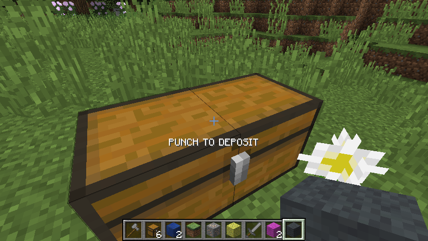
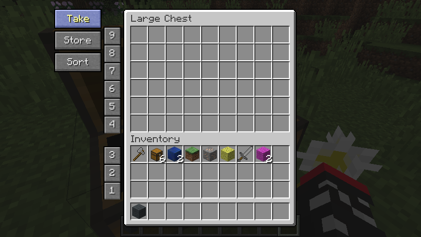
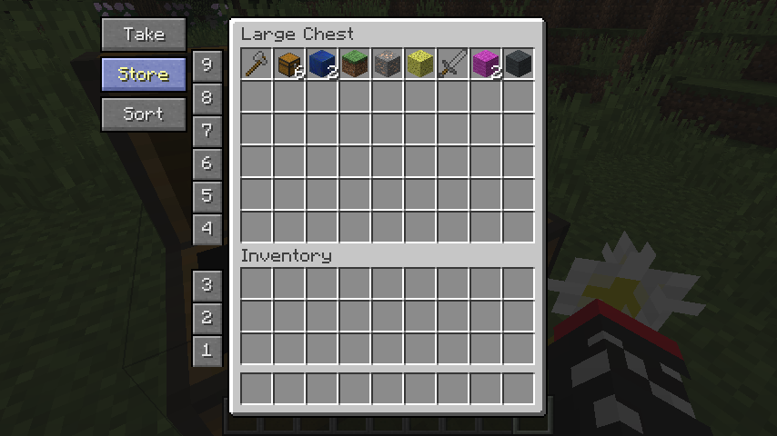
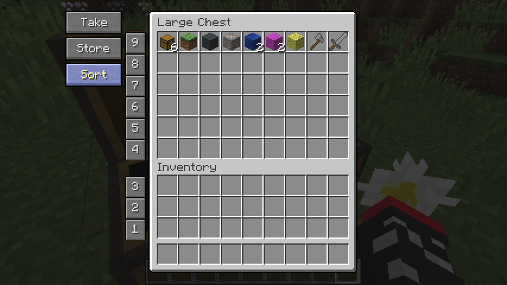
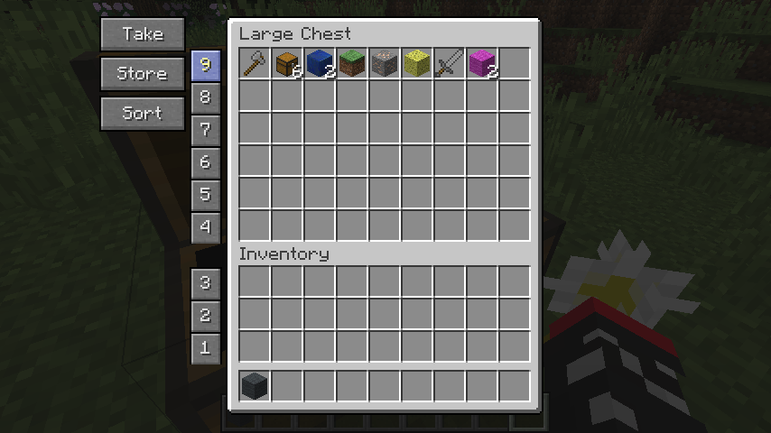
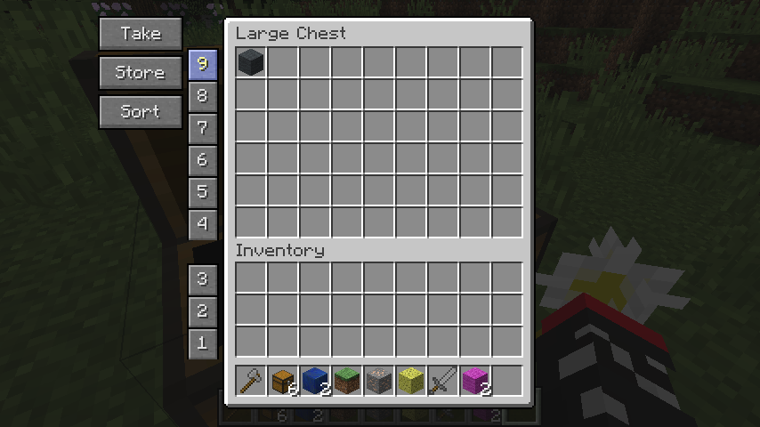

# Fire's Storage Tweaks

**Inventory management and storage search for Minecraft 1.12.2 (Forge).**

Move entire inventories, sort items, swap rows with your hotbar, find items in nearby storage, and deposit items without opening a chest.



**Version:** 0.0.1 · **Minecraft:** 1.12.2 · **Forge:** 14.23.5.2864 · **Java:** 8 · **License:** AGPL-3.0-or-later

[Compatibility](https://github.com/firebadnofire/storage-tweaks/blob/HEAD/docs/compatibility.md) | [Testing](https://github.com/firebadnofire/storage-tweaks/blob/HEAD/docs/testing.md) | [Finder documentation](https://github.com/firebadnofire/storage-tweaks/blob/HEAD/docs/finder.md) | [Protocol](https://github.com/firebadnofire/storage-tweaks/blob/HEAD/docs/protocol.md)

This is an independently implemented development build with runtime-tested scenarios. Forge 1.12.2 is the sole target; modpack compatibility is limited to the documented tests.

## Features

### Take, Store, and Sort

Manage supported vanilla chests and shulker boxes with three dedicated buttons:

- **Take:** Move container contents into your inventory, including the hotbar where applicable.
- **Store:** Move inventory contents into the container, including the hotbar. Tools are not excluded by default.
- **Sort:** Consolidate and organize items. In the survival inventory and creative player-inventory tab, sorting orders the main 27 slots by displayed name without touching the hotbar, armor, offhand, or crafting slots.

| Take | Store | Sort |
| :---: | :---: | :---: |
|  |  |  |

### Swap rows with your hotbar

Exchange an entire row with your hotbar using the numbered buttons beside the inventory or chest. Both rows retain their column order and exact stacks, without merging compatible stacks.

| Before swapping row 9 | After swapping row 9 |
| :---: | :---: |
|  |  |

| Rows | Location |
| --- | --- |
| 1–3 | Player inventory, numbered upward from the row nearest the hotbar |
| 4–6 | Small chest or lower three rows of a double chest |
| 7–9 | Upper three rows of a double chest |

Available in survival inventory, the creative player-inventory tab, and small and double chests. The hotbar itself has no button. Armor, offhand, crafting, and unselected rows remain untouched.

### Punch to deposit

Deposit held items directly into vanilla chests and ender chests without opening their GUI. The feature is negotiated with the server and server-authoritative. Tools and damageable equipment require a held override key (Left Shift by default).

### Find entities, blocks, and items

Use client-side `/cfind`, `/cfindblock`, and `/cfinditem` to locate entities, blocks, and items in reachable storage. Item search uses normal container interactions, hides intermediate screens, and opens the container with the most matches. Your view remains unchanged during the scan and faces the best match only after it finishes.

See [exact syntax and limitations](https://github.com/firebadnofire/storage-tweaks/blob/HEAD/docs/finder.md).

### Multiplayer support

| Feature | Client mod required | Server mod required |
| --- | :---: | :---: |
| Inventory controls and row swapping | Yes | No |
| Finder commands | Yes | No |
| Punch deposit | Yes | Yes |

Servers with the mod accept unmodified clients. No punch workaround runs on unsupported servers. Inventory operations use legal, paced clicks with confirmation, state checks, and a timeout. Interrupted operations preserve cursor contents; put them away normally.

## Installation and controls

Install the `*-mc1.12.2-forge.jar` in the Forge instance's `mods` directory. Do not
install the sources or runtime-test JAR. Dedicated servers use the same mod JAR.
Java 8 is the tested runtime. Back up worlds before testing development software.

Use Mods → Storage Tweaks → Config, or the rebindable P settings shortcut. If P is
already assigned, the shortcut starts unbound; assign it in Controls. A cancel
shortcut is also available, initially unbound. Feature toggles, pacing, search
budgets, exclusions, and capability status are available in settings. Configuration
is persisted by Forge.

The nine **Swap Row N with Hotbar** bindings in Controls start unbound.
Rows 1-3 work in player inventory, supported chests, or with no screen open;
rows 4-9 require a chest containing that row. Numbering runs upward from the
player row nearest the hotbar. Disable the separate
`inventorySwap` setting to disable row buttons and bindings. Swaps require an empty
cursor and no other inventory operation or item search; manual interaction or an
inventory change stops the remaining swaps safely. A row swap consists of up to
nine acknowledged exchanges, so an interrupted operation may be partly complete.

**Override Punch Deposit Protection (Hold)** is rebindable in Controls and defaults
to Left Shift. Protected tools, weapons, damageable equipment, and configured
`punchExclusions` items deposit only while it is held. Their availability label
shows `[SHIFT]` underneath, or the rebound key (`[UNBOUND]` if unassigned).
All server access and capacity checks still apply.

When loader mod ID `clientcommands` is present, all three finder commands and their
services are skipped. Other command-name collisions are skipped with a log message.
The upstream mod is a read-only behavioral reference, not a runtime dependency.

## Commands

| Command | Operation |
| --- | --- |
| `/punchdeposit <true\|false>` | Server-wide persisted punch toggle. Console/admins on dedicated servers; singleplayer owner needs no OP. |
| `/clook <x> <y> <z>` | Aim at the center of a block, without moving or interacting. Supports `~` relative coordinates. Finder results include an aqua, underlined [Look at] action; open chat (T) to click it. |
| `/cfind <selector-or-name-or-UUID> [--keep-searching]` | Find entities known to the client. |
| `/cfindblock <block> [metadata-or-state-properties] [--keep-searching]` | Find blocks in loaded chunks. Inline `<block>[property=value,...]` is also supported. |
| `/cfinditem <item> [metadata] [--keep-searching]` | Inspect reachable storage through normal interactions; scan all reachable containers and open the one with the most matches. |
| `/cfind cancel` | Cancel the entity search. |
| `/cfindblock cancel` | Cancel the block search. |
| `/cfinditem cancel` | Cancel the item search and release screen suppression. |

The server command uses Forge's permission node
`firebadnofire_storage_tweaks.command.punchdeposit`, defaulting to operators.
Permission providers that implement [Forge PermissionAPI](https://docs.minecraftforge.net/en/1.12.x/utilities/permissionapi/) can grant or deny it,
including compatible LuckPerms bridges; no particular LuckPerms distribution has
been tested. The singleplayer owner bypasses OP checks; other LAN players do not.
Changing the toggle refreshes negotiated clients immediately. Enabling it preserves
all access checks and the conservative restriction on unreviewed protection mods.

Use registry IDs, for example `/cfinditem minecraft:apple`,
`/cfindblock minecraft:wool 2`, or `/cfind @e[type=pig,r=32]`.
Entity selectors are `@e`, `@a`, `@p`, `@r`, and `@s`; supported filters are
`type`, `name`, `tag`, `r`, `rm`, `c`, `x`, `y`, `z`, `dx`, `dy`, and `dz`.
Type, name, and tag accept `!` negation. Metadata is the legacy numeric variant.
`--keep-searching` repeats searches until cancelled; item search still stops and
shows the best match after a full scan. Results provide coordinate suggestions and clickable
cancellation. Item search requires an empty cursor and no open inventory or active
inventory job; entering its command through chat is allowed. No OP permission or
server mod is required. See [finder details and limits](https://github.com/firebadnofire/storage-tweaks/blob/HEAD/docs/finder.md).

## Important limits

Only explicitly recognized vanilla handlers are admitted. Arbitrary modded
containers are unsupported. The label requires a recent positive server access
and capacity probe; the actual punch validates access again.
On a compatible enabled server, eligible chest clicks attempt deposit immediately;
they do not wait for the hover label. Slot synchronization precedes the request.
Full or denied deposits never fall through to mining. To break a chest, hold an
empty hand or protected tool without holding the override, or disable client punch. Update both client and
server JARs to receive the improved rapid-click handling. Network/server processing
time still applies; the hover label remains server-confirmed.

There is currently no third-party protection integration: additional unreviewed
server mods disable punch conservatively. The reviewed Traveler's Backpack 1.0.35
build is supported alongside vanilla-storage punch. See [the protocol](https://github.com/firebadnofire/storage-tweaks/blob/HEAD/docs/protocol.md).

Entity and block searches can reveal terrain-obscured data already sent to the
client. Multiplayer rules may restrict their use. Searches never load distant
chunks or query privileged NBT.

## Build and validation

Pinned tools: JDK 8, Gradle 4.9, ForgeGradle 3.0.197, stable mappings 39-1.12,
Forge 14.23.5.2864. From PowerShell, set `JAVA_HOME` to a JDK 8 installation and
`GRADLE_USER_HOME` to a cache on a drive with sufficient space, then run:

```powershell
.\gradlew.bat --no-daemon :common:test :forge-1.12.2:build
```

`scripts/Validate.ps1 -JavaHome <jdk8> -GradleHome <cache>` also writes SHA-256
sidecars. Add `-RuntimeTest` with the documented WSL/Xvfb prerequisites to run
integrated-server assertions on a private virtual display, with 0% master volume
and software rendering. This creates fresh test worlds in the isolated validation
directory; it stops if private-display tools are unavailable.
The development `runClient` task currently has an upstream class-merging problem;
the private test harness uses official Forge binaries for runtime validation.

## License and release process

AGPL-3.0-or-later, preserving the existing project license. Reference provenance
and actual upstream licenses are recorded in [licensing](https://github.com/firebadnofire/storage-tweaks/blob/HEAD/docs/licensing.md) and
[NOTICE](https://github.com/firebadnofire/storage-tweaks/blob/HEAD/NOTICE). A pushed `v*`/`V*` tag runs the pinned Java 8 build, exact-JAR
dedicated-server smoke test, GPG signing, and Forgejo release publication after
asset-inventory and server-reported-size checks. Remote release assets are not downloaded
by the publisher. Repository secrets `CI_KEY_B64` and `CI_KEY_PASSPHRASE` are required
only for that tag-release step; ordinary builds never access them. The tag-release step
fast-forwards the verified main commit to github.com/firebadnofire/storage-tweaks using
GH_KEY; it never force-pushes or retargets GitHub tags. If a tag publication stops after
staging a draft, use the separate Recover signed release workflow with that tag and the
original tag-run API ID; it reuses the original tested artifacts without retagging.


Version: **0.0.1**. Creator: **FireBADnoFire**.
